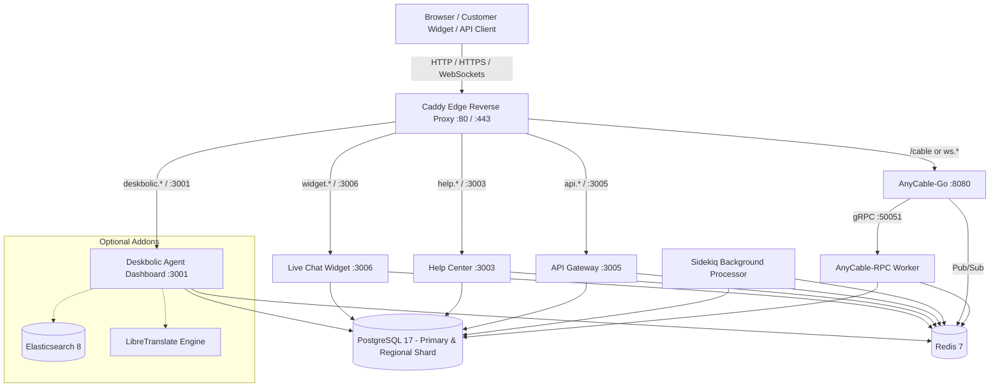

# ⚡ Deskbolic — Open-Source Customer Communication Platform

**The modern, open-source customer communication platform and omnichannel shared inbox.**  
An open-source alternative to Intercom, Zendesk, and Crisp.

[Docker Quickstart](#-quick-start-with-docker) • [Architecture](#-system-architecture) • [App Ecosystem](#-application-ecosystem) • [Configuration](#-environment-configuration) • [Database & Shards](#-database--sharding-management) • [Systemd & Bare-Metal](#-bare-metal--systemd-deployment) • [License](#-license)

---

## 📖 Overview

Deskbolic is a full-featured customer support and messaging infrastructure designed for startups, modern teams, and privacy-conscious enterprises. It brings together live chat, ticketing, email management, automations, and knowledge base into a single unified platform.

Key Capabilities:
- **Omnichannel Agent Dashboard**: Real-time team inbox, ticket triage, customer CRM, conversation assignments, and collision detection.
- **Embeddable Chat Widget**: Lightweight, responsive customer chat widget ready to drop into any website or single-page application.
- **Multitenant Help Center (Helpbolic)**: Public knowledge base with custom domain support and instant article search.
- **Unified API Gateway**: Dedicated ingress for REST APIs, webhooks, and third-party integrations.
- **Enterprise WebSockets (AnyCable)**: Sub-millisecond live chat, typing indicators, and presence tracking scaling to tens of thousands of concurrent connections.
- **Data Sovereignty & GDPR Isolation**: Built-in multi-database sharding supporting European and regional data isolation out of the box.

---

## 🏗 System Architecture

Deskbolic runs on containerized services inspired by high-performance bare-metal topologies:



---

## 📦 Application Ecosystem

Deskbolic is composed of modular applications sharing a unified database and core engine:

| Application | Port | Role & Capabilities |
| :--- | :--- | :--- |
| **Deskbolic Web** | `3001` | Agent portal, omnichannel triage, team inbox, conversation assignment rules, canned replies, and settings. |
| **Widget** | `3006` | Customer-facing embeddable live chat widget loaded cross-origin in customer websites. |
| **Helpbolic** | `3003` | Knowledge base, help articles, customer FAQ, and on-demand custom domain mapping. |
| **Gateway** | `3005` | Inbound webhook receivers, public REST endpoints, and authentication middleware. |
| **AnyCable-Go** | `8080` | High-concurrency Go server holding thousands of open WebSocket connections with minimal RAM. |
| **AnyCable-RPC** | `50051` | Rails gRPC worker that handles authentication, authorization, and subscription logic for channels. |
| **Worker (Sidekiq)**| *Internal* | Multithreaded background worker handling transactional mail, SLA timers, automations, and syncs. |

---

## 🚀 Quick Start with Docker

The fastest way to deploy the entire Deskbolic stack is with Docker Compose.

### 1. Prerequisites
- [Docker Engine](https://docs.docker.com/engine/install/) (v24+)
- [Docker Compose](https://docs.docker.com/compose/) (v2+)

### 2. Clone Repositories
Clone the repositories side-by-side:
```bash
mkdir -p ~/deskbolic-stack
cd ~/deskbolic-stack

git clone https://github.com/deskbolic/core.git
git clone https://github.com/deskbolic/deskbolic.git
git clone https://github.com/deskbolic/widget.git
git clone https://github.com/deskbolic/helpbolic.git
git clone https://github.com/deskbolic/gateway.git

cd deskbolic
```

### 3. Setup Environment
```bash
cp .env.example .env
```

### 4. Launch the Complete Stack
```bash
docker compose up -d
```

Docker Compose will automatically:
1. Boot PostgreSQL 17 and create both the primary database and the European regional shard (`deskbolic_de_production`).
2. Boot Redis 7 and AnyCable-Go.
3. Build all four application containers (`deskbolic`, `widget`, `helpbolic`, `gateway`).
4. Run all database migrations and initial seeders.
5. Launch Caddy edge proxy routing all services on ports `80` and `443`.

### 5. Accessing Services

Modern web browsers automatically resolve `*.localhost` to `127.0.0.1` without any `/etc/hosts` changes:

- **Agent Dashboard**: [http://localhost](http://localhost) or [http://deskbolic.localhost](http://deskbolic.localhost)
- **Live Chat Widget**: [http://widget.localhost](http://widget.localhost) (or [http://localhost/widget](http://localhost/widget))
- **Help Center (Helpbolic)**: [http://helpbolic.localhost](http://helpbolic.localhost) (or [http://localhost/help](http://localhost/help))
- **API Gateway**: [http://api.localhost](http://api.localhost) (or [http://localhost/api](http://localhost/api))
- **WebSocket Gateway**: `ws://localhost/cable` or `ws://ws.localhost`

#### Default Super Admin Credentials:
- **Email:** `admin@example.com` *(or `ADMIN_DEFAULT_EMAIL` in `.env`)*
- **Password:** `ChangeMe123#`

---

## 🛠 Useful Docker Commands

```bash
# View live logs across all containers
docker compose logs -f

# View logs for a specific application
docker compose logs -f deskbolic
docker compose logs -f widget
docker compose logs -f helpbolic

# Open a Rails Console inside the running Deskbolic container
docker compose exec deskbolic bundle exec rails console

# Run migrations manually
docker compose exec deskbolic bundle exec rails db:migrate db:migrate:de

# Run seeders
docker compose exec deskbolic bundle exec rails db:seed

# Restart all services
docker compose restart

# Stop all containers (data in PostgreSQL and Redis volumes is preserved)
docker compose down
```

---

## ⚙️ Environment Configuration

The entire stack is configured via the `.env` file in the `deskbolic/` root:

### Core Configuration
| Variable | Description | Default |
| :--- | :--- | :--- |
| `RAILS_ENV` | Rails environment mode | `production` |
| `SECRET_KEY_BASE` | 128-hex character secret for signing sessions & cookies | *(pre-configured template)* |
| `RAILS_SERVE_STATIC_FILES` | Serve assets directly from `/public` | `true` |
| `RAILS_LOG_TO_STDOUT` | Stream application logs to Docker stdout | `true` |
| `FORCE_SSL` | Force redirect all HTTP traffic to HTTPS | `false` *(set `true` when using external SSL)* |
| `ASSUME_SSL` | Trust SSL termination from reverse proxy | `false` |

### Hosts & Domains
| Variable | Description | Default |
| :--- | :--- | :--- |
| `APP_DOMAIN` | Host for the agent dashboard | `localhost` |
| `MAIN_DOMAIN` | Root domain for cookie sharing and tenant subdomains | `localhost` |
| `WIDGET_DOMAIN` | Host for the live chat widget | `widget.localhost` |
| `HELP_DOMAIN` | Host for the Helpbolic knowledge base | `helpbolic.localhost` |
| `API_DOMAIN` | Host for the API gateway | `api.localhost` |
| `WS_DOMAIN` | Host for the AnyCable WebSocket daemon | `ws.localhost` |

### Database & Redis
| Variable | Description | Default |
| :--- | :--- | :--- |
| `DB_HOST` | PostgreSQL hostname | `postgres` |
| `DB_PORT` | PostgreSQL port | `5432` |
| `DB_USERNAME` | Database username | `postgres` |
| `DB_PASSWORD` | Database password | `postgres` |
| `DB_POOL` | Connection pool size per Puma process | `10` |
| `REDIS_URL` | Redis cache URL (database 0) | `redis://redis:6379/0` |
| `SIDEKIQ_REDIS_URL` | Redis queue URL for Sidekiq (database 1) | `redis://redis:6379/1` |
| `ANYCABLE_REDIS_URL` | Redis pub/sub URL for AnyCable (database 2) | `redis://redis:6379/2` |

### Default Admin & Automated Seeding
| Variable | Description | Default |
| :--- | :--- | :--- |
| `RUN_MIGRATIONS` | Automatically run primary & shard migrations on boot | `true` |
| `RUN_SEEDS` | Seed initial admin account and default settings on first boot | `true` |
| `ADMIN_DEFAULT_EMAIL`| Email for the super-admin account | `admin@example.com` |
| `ADMIN_DEFAULT_PASSWORD` | Password for the super-admin account | `ChangeMe123#` |
| `ADMIN_DEFAULT_NAME` | Display name for the super-admin | `Deskbolic Admin` |

---

## 🗄 Database & Sharding Management

Deskbolic employs regional database sharding to allow horizontal scaling and GDPR data isolation.

### 1. Migrations
The database schema consists of primary tables (`db/migrate`) and shard tables (`db/migrate_shards`):
```bash
# Migrate primary database
bin/rails db:migrate

# Migrate regional shard database (German / EU Shard)
bin/rails db:migrate:de

# Rollback a shard migration
bin/rails db:rollback:de
```

### 2. Seeds
To populate system roles, permissions, and default accounts:
```bash
bin/rails db:seed
```

---

## ⚡ Real-Time WebSockets (AnyCable)

Standard Rails ActionCable runs inside Ruby processes, which can consume hundreds of megabytes of memory under high WebSocket loads. Deskbolic uses **AnyCable**:
- **AnyCable-Go** accepts client connections over WebSockets (`ws://` or `wss://`).
- It forwards subscription authentication requests to **AnyCable-RPC** over high-speed gRPC.
- Broadcasting an event (e.g., `MessageChannel.broadcast_to(conversation, payload)`) publishes to Redis (`ANYCABLE_REDIS_URL`), and AnyCable-Go instantly broadcasts it to all connected browser clients.

---

## 🖥 Bare-Metal & Systemd Deployment

If you are running on dedicated Linux servers, Proxmox VE, or bare-metal infrastructure instead of Docker, battle-tested systemd unit files and Caddy configuration are available:

- Systemd Service Units: `deploy/systemd/`
  - `deskbolic-puma.service` (Port 3001)
  - `deskbolic-widget.service` (Port 3006)
  - `deskbolic-helpbolic.service` (Port 3003)
  - `deskbolic-gateway.service` (Port 3005)
  - `deskbolic-sidekiq.service`
  - `anycable-rpc.service` (Port 50051)
  - `anycable-go.service` (Port 8080)
- Production Caddyfile: `deploy/caddy/Caddyfile.production`

For setup instructions, see the [deploy/README.md](file:///Users/ahsan/Projects/deskbolic/deskbolic/deploy/README.md) documentation.

---

## 🤝 Community & Support

- ⭐️ **Star the repo** on GitHub to support open-source development.
- 🐛 **Issue Tracker**: Report bugs or request features via [GitHub Issues](https://github.com/deskbolic/deskbolic/issues).
- 💖 **Sponsor the Author**: Support open-source maintenance at [github.com/sponsors/mahsanzahid](https://github.com/sponsors/mahsanzahid).

---

## 📄 License

Deskbolic is open-source software licensed under the **GNU Affero General Public License v3.0 (AGPL-3.0)**.  
Free for personal, commercial, and enterprise self-hosting.
